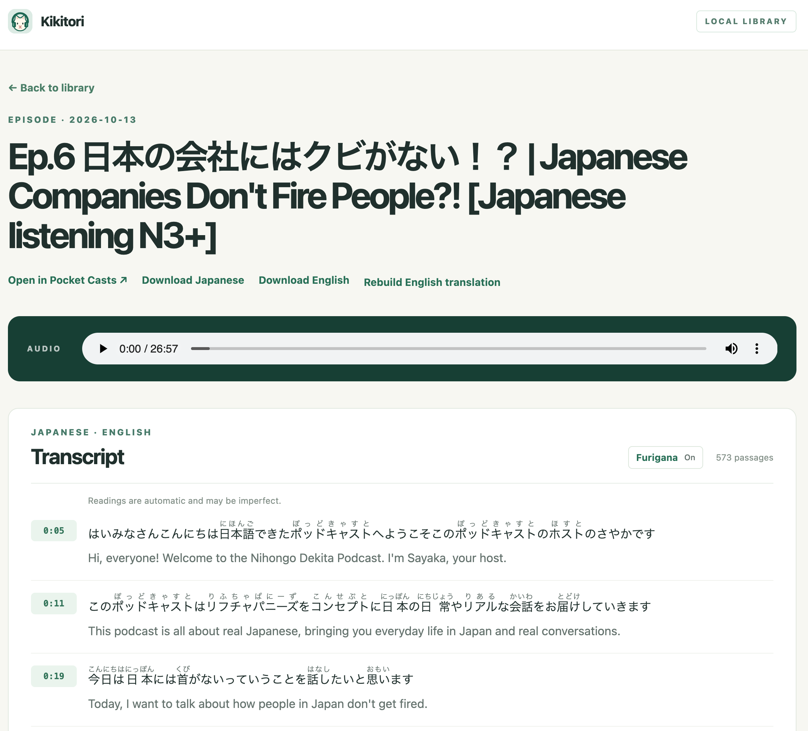

# Kikitori



A local web library for Japanese podcast episodes. Paste a Pocket Casts episode page or a direct audio URL, then listen and read timestamped Japanese and English transcripts.

## Start

On a machine with Nix flakes and `just` installed, run:

```sh
just dev
```

Open [http://127.0.0.1:8765](http://127.0.0.1:8765). On first launch, LiteLLM starts a ChatGPT device login in the terminal; follow its URL and code prompt. Japanese speech is transcribed locally with the `faster-whisper` small model on CPU. GPT-6 Luna then translates Japanese passages in context, keeping each English result aligned with its Japanese passage and timestamp. Audio stays on your machine; transcript text is sent to the ChatGPT service. Translation uses your ChatGPT plan allowance through LiteLLM and does not require an OpenAI API key. A long episode can still take several minutes. The page shows the current stage and updates when processing finishes.

The app binds only to `127.0.0.1` by default. Use `just dev 9000` to choose another port. To move the library, run `nix develop --command uv run kikitori --data-dir /path/to/library`. By default, audio and transcripts are stored in `./data/`, one directory per episode. Keep that directory to preserve the library across restarts.

## Supported links

- Full public Pocket Casts episode pages, such as `https://pocketcasts.com/podcast/.../.../.../...`.
- Apple Podcasts episode links with an episode ID, such as `https://podcasts.apple.com/us/podcast/show/id123456?i=789012`. Episodes must have public publisher audio.
- Direct public HTTP(S) audio URLs, including redirects from podcast hosts.

Pocket Casts [does not offer a public API](https://support.pocketcasts.com/knowledge-base/pocket-casts-api/). This app uses a currently available episode lookup to resolve a Pocket Casts page to its original audio URL. If Pocket Casts changes that lookup or an older episode is not returned, use the direct audio URL instead. Private feeds and arbitrary podcast page sites are not supported yet.

## Files and search

Each episode keeps `metadata.json`, the downloaded audio, `transcript_ja.json` with word timestamps, `transcript_en.json`, and readable `transcript_ja.txt` and `transcript_en.txt`. The library searches saved titles and both text transcripts directly from files. There is no database or separate search service.

The player and timestamps on an episode page let you jump into the audio. The page links back to its original source. Japanese readings appear as furigana by default and can be hidden with the Furigana toggle. Readings are generated locally and may be imperfect; downloads keep the original Japanese text. English text is generated from the Japanese transcript by GPT-6 Luna and may need human correction, especially for idioms or transcription errors. Punctuation comes from Whisper and can still be imperfect; rebuilding English does not change the Japanese wording.

For saved episodes, use **Rebuild English translation** on the episode page to regenerate English passage by passage. This reuses the saved Japanese transcript without downloading or transcribing the audio again. New jobs also save Japanese before translation, so failed translations can be retried without repeating Whisper. Rebuilding sends the saved Japanese transcript to the ChatGPT service.

## Development

```sh
nix develop --command uv run --extra test pytest -q
```

## Translation quality

A sample from one episode was evaluated in [docs/translation-evaluation.md](docs/translation-evaluation.md). New translations use GPT-6 Luna; saved translations remain unchanged until rebuilt from the episode page.
